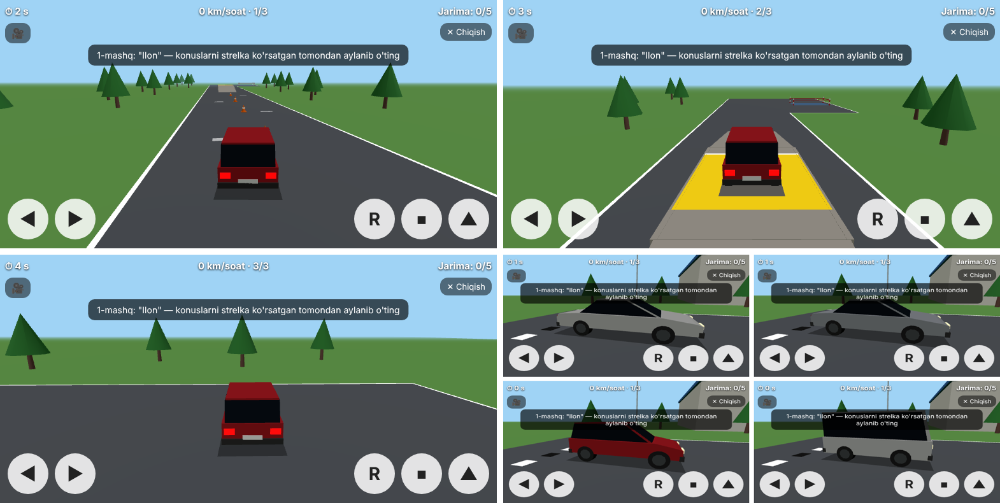

# Prava Mashq — Telegram bot

Telegram bot va uning ichida ochiladigan Mini App: **3D avtodrom** va **yo'l harakati qoidalari testi**.



## 3D avtodrom

- **Mashinalar:** Cobalt, Nexia, Spark, Damas (past poligonli 3D modellar, logotipsiz).
- **Mashqlar:**
  1. "Ilon": konuslarni navbat bilan chap va o'ng tomondan aylanib o'tish;
  2. estakada: qiyalikka chiqib, sariq zonada to'xtash va orqaga ketmasdan yo'lda davom etish;
  3. garajga **orqa bilan** kirib to'xtash.
- **Jarimalar:** konusga urilish, noto'g'ri tomondan o'tish, sariq zonada to'xtamaslik, qiyalikda orqaga ketish, garaj to'sig'iga tegish (har biri +3). 5 balldan oshsa — o'tmadi. Maydondan yoki estakadadan chiqib ketish — darhol o'tmadi.
- **Boshqaruv:** ◀ ▶ rul, ▲ gaz, ⏹ tormoz, R orqaga yurish, 🎥 kamera (orqadan, tepadan, kabinadan). Kompyuterda: strelkalar va probel.
- 3D grafika Three.js (MIT litsenziyasi) yordamida chiziladi. Kutubxona `webapp/vendor/` ichida, internetdan yuklanmaydi.

> ⚠️ Mashina nomlari (Cobalt, Nexia, Spark, Damas) GM va UzAuto Motors'ning savdo belgilari. Pullik mahsulotda ishlatishdan oldin huquqiy maslahat oling yoki nomlarni umumiy nomlarga almashtiring (`webapp/avtodrom3d.js` dagi `CARS`).

## Imkoniyatlar

| Qism | Bepul | To'liq versiya |
|---|---|---|
| Avtodrom | ✅ | ✅ |
| Mashq testi | 10 ta savol | barcha savollar |
| Imtihon (20 savol, 25 daqiqa, 2 tagacha xato) | 🔒 | ✅ |

- To'lov **Telegram Stars** orqali qabul qilinadi (narx: `.env` dagi `PRICE_STARS`).
- To'lov foydalanuvchining Telegram akkauntiga bog'lanadi. Havolani boshqa odamga yuborsa ham, u odam to'lamagan bo'lsa, to'liq versiya ochilmaydi.
- Server har bir so'rovda Telegram imzosini (initData) tekshiradi, shuning uchun to'lov holatini soxtalashtirib bo'lmaydi.

## Nega Telegram Stars?

Telegram qoidalariga ko'ra, bot ichida sotiladigan raqamli mahsulot va xizmatlar (test, kurs, o'yin) uchun to'lov faqat **Telegram Stars** orqali olinadi. Buning qulay tomoni: Click yoki Payme bilan shartnoma, YaTT yoki firma talab qilinmaydi. Yig'ilgan Stars'ni Fragment orqali yechib olish mumkin (Telegram shartlariga qarang).

> 5 000 so'm taxminan 25–30 Stars'ga to'g'ri keladi. Stars narxi o'zgarib turadi, shuning uchun `PRICE_STARS` ni o'zingiz sozlang.

## Ishga tushirish

1. **Bot yarating:** Telegram'da @BotFather → `/newbot` → tokenni oling.
2. **Server tayyorlang:** Mini App faqat **HTTPS** manzilda ishlaydi. Variantlar: VPS va domen (masalan, Caddy yoki Nginx orqali HTTPS), yoki Render, Railway kabi xizmatlar.
3. **Fayllarni serverga ko'chiring va sozlang:**
   ```bash
   pip install -r requirements.txt
   cp .env.example .env      # BOT_TOKEN, WEBAPP_URL, PRICE_STARS ni to'ldiring
   python3 app.py
   ```
4. **Mini App'ni botga ulang (ixtiyoriy):** @BotFather → `/mybots` → botingiz → *Bot Settings → Menu Button* → `WEBAPP_URL`.
5. **Instagram:** profil "bio"siga bot havolasini qo'ying: `https://t.me/BOT_NOMI`.

Lokal sinov (Telegram'siz): `DEV=1 python3 app.py`, keyin brauzerda `http://localhost:8080/?dev=1` ni oching.

## Savollar bazasi

Savollar `questions.json` faylida. Har bir savol:

```json
{"id": 51, "t": "Mavzu", "s": "stop", "q": "Savol matni", "o": ["Javob 1", "Javob 2", "Javob 3"], "a": 1, "e": "Izoh"}
```

- `a` — to'g'ri javobning raqami (0 dan boshlanadi).
- `s` — ixtiyoriy belgi rasmi: `stop`, `giveway`, `noentry`, `warning`, `straight`, `crossing`, `redlight`, `yellow`, `rail`, `solid`, `dashed`.
- Yangi savol qo'shgach, botni qayta ishga tushiring.

⚠️ Savollar yo'l harakati qoidalarining umumiy tamoyillari asosida tuzilgan. Pullik versiyani ishga tushirishdan oldin ularni O'zbekistonning amaldagi YHQ'siga solishtirib tekshiring.

## Fayllar

- `app.py` — bot, to'lov va Mini App uchun server (API)
- `webapp/index.html` — Mini App: bosh sahifa va test
- `webapp/avtodrom3d.js` — 3D avtodrom
- `questions.json` — savollar bazasi
- `users.db` — foydalanuvchilar va to'lovlar (avtomatik yaratiladi, zaxira nusxasini saqlang)
