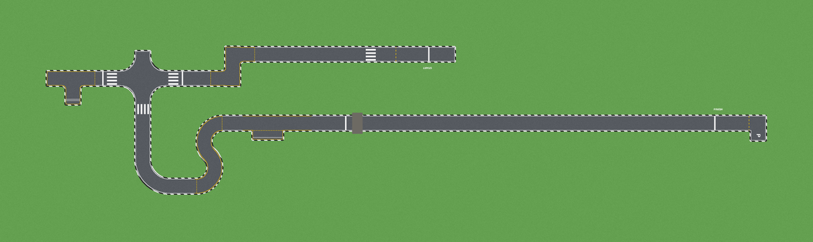
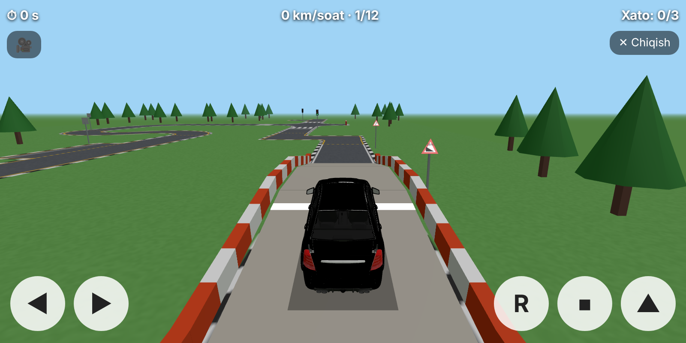

# Prava Mashq — Telegram bot

Telegram bot va uning ichida ochiladigan Mini App: **3D avtodrom** va **yo'l harakati qoidalari testi**.

## 3D avtodrom

Avtodrom **IIV vazirining 2024-yil 18-yanvardagi 27-son buyrug'i** bilan tasdiqlangan "O'quv avtodromiga qo'yiladigan talablar" (Adliya vazirligida 01.02.2024 da 3494-son bilan ro'yxatga olingan) asosida qurilgan: mashqlar ketma-ketligi 3-bandga, o'lchamlar 4-ilovaning 2-bobiga ("B" toifa) mos. Sxemalardagi kabi yo'laklar tanlangan mashinaning kengligi (V) va uzunligiga (D) qarab hisoblanadi.



| № | Mashq | Rasmiy o'lcham va talablar |
|---|---|---|
| 1 | Harakatni boshlash (START) | START chizig'i 0,4 m; 10 m dan keyin 3.24 "20 km/soat" belgisi |
| 2 | Piyodalar o'tish joyi | 1.14.1 chizig'i, 5.16 belgilari; piyoda yo'lni kesib o'tadi |
| 3 | Estakada | qiyalik 16 %, L1 = 6 m, L2 = 4 m; 0,4 m li to'xtash chizig'i cho'qqidan 1,0 m oldin; 0,5 m to'siqlar; 1.14 va 1.13 belgilari |
| 4 | 90° burilishlar | 11,5 m, ichki burchak radiusi 1 m, yo'lak 2÷2,5·V |
| 5 | Tor joyda qayrilib olish (boks) | boks chuqurligi D+1, kengligi 2÷2,5·V, R 1 m |
| 6 | Svetoforli chorraha | burilish radiusi > 4 m (4,5 m), to'xtash chizig'i 0,4 m, piyodalar yo'lagidan 1 m oldin |
| 7 | Ilon izi | tashqi radius 7,65 m, ikki 135° yoy, yo'lak 2÷2,5·V |
| 8 | Parallel parkovka | cho'ntak uzunligi 1,8÷2,2·D (2,0·D), chuqurligi V+1 |
| 9 | Temir yo'l kesishmasi | to'xtash chizig'i relsdan ≥ 2,0 m oldin; 1.2, 1.3.1, 2.5 belgilari; 1520 mm koleya |
| 10 | Tezlashish bo'lagi | 40 m; 4.7 "Eng kam tezlik 20" (buyruqda eski raqami 4.6), 3.24 "40", oxirida 3.24 "20" |
| 11 | Avariya holatda to'xtash | signal yonganda darhol to'xtash |
| 12 | Harakatni yakunlash (FINISH) | finish maydoni 10 m, undan keyin to'xtab turish joyi |

- **Mashinalar:** Gentra, Cobalt, Malibu, Spark, Damas. O'lchamlari (uzunlik, kenglik, g'ildirak bazasi) ishlab chiqaruvchi ma'lumotlaridan olingan. Gentra, Malibu va Damas — 3D modellar (CC BY 4.0, mualliflar `webapp/models/CREDITS.md` da), Cobalt va Spark — oddiy modellar.
- **Fizika:** velosiped modeli. Mashina orqa o'q atrofida buriladi, rulning eng katta burchagi 38°. Qiyalikda tormozni qo'yib yuborsangiz, mashina orqaga ketadi.
- **Tekshiriladi:** chegara chizig'i va bordyurga tegish, avtodromda 20 km/soatdan oshish, piyodaga yo'l bermaslik, estakadada va temir yo'l oldida to'xtamaslik, estakadada orqaga ketish, svetoforning qizil ishorasi, parkovkada bordyurga yaqin turmaslik, tezlashish bo'lagidagi tezliklar, avariya signaliga kech javob.
- **O'yin shartlari** (buyruqda yo'q, o'yin uchun tanlangan): 3 ta xatoda imtihon to'xtaydi; estakadada orqaga 0,3 m dan ko'p ketish xato; avariya mashqida tormoz 1 soniya ichida bosilishi va tezlik kamida 15 km/soat bo'lishi kerak; boks va parkovkadagi nazorat chizig'i sxemadagi joyiga yaqin chizilgan (sxemada aniq raqam berilmagan); vaqt — 15 daqiqa.
- **Tekshiruv:** avtopilot testi 5 ta mashinaning har biri bilan 12 ta mashqni xatosiz o'tdi.
- **Boshqaruv:** ◀ ▶ rul, ▲ gaz, ⏹ tormoz, R orqaga yurish, 🎥 kamera (orqadan, tepadan, kabinadan). Kompyuterda: strelkalar va probel.
- 3D grafika Three.js (MIT litsenziyasi) yordamida chiziladi. Kutubxona `webapp/vendor/` ichida, internetdan yuklanmaydi.



> ⚠️ Mashina nomlari (Gentra, Cobalt, Malibu, Spark, Damas) GM va UzAuto Motors'ning savdo belgilari. Pullik mahsulotda ishlatishdan oldin huquqiy maslahat oling yoki nomlarni umumiy nomlarga almashtiring (`webapp/avtodrom3d.js` dagi `CARS`).

## Imkoniyatlar

| Qism | Bepul | To'liq versiya |
|---|---|---|
| Avtodrom | ✅ | ✅ |
| Mashq testi | 10 ta savol | barcha savollar |
| Imtihon (20 savol, 25 daqiqa, 2 tagacha xato) | 🔒 | ✅ |

- To'lov **Telegram Stars** orqali qabul qilinadi (narx: `.env` dagi `PRICE_STARS`).
- To'lov foydalanuvchining Telegram akkauntiga bog'lanadi. Havolani boshqa odamga yuborsa ham, u odam to'lamagan bo'lsa, to'liq versiya ochilmaydi.
- Server har bir so'rovda Telegram imzosini (initData) tekshiradi, shuning uchun to'lov holatini soxtalashtirib bo'lmaydi.

## Nega Telegram Stars?

Telegram qoidalariga ko'ra, bot ichida sotiladigan raqamli mahsulot va xizmatlar (test, kurs, o'yin) uchun to'lov faqat **Telegram Stars** orqali olinadi. Buning qulay tomoni: Click yoki Payme bilan shartnoma, YaTT yoki firma talab qilinmaydi. Yig'ilgan Stars'ni Fragment orqali yechib olish mumkin (Telegram shartlariga qarang).

> 5 000 so'm taxminan 25–30 Stars'ga to'g'ri keladi. Stars narxi o'zgarib turadi, shuning uchun `PRICE_STARS` ni o'zingiz sozlang.

## Ishga tushirish (Railway)

Bot bitta jarayonda ishlaydi: Telegram'ni doimiy tinglaydi va Mini App sahifasini ham o'zi beradi. Shuning uchun server **uxlamasligi** va `users.db` (kim to'lagani) **doimiy diskda** turishi kerak. Railway ikkalasini ham beradi.

1. **Bot yarating:** Telegram'da @BotFather → `/newbot` → tokenni oling. Tokenni hech kimga yubormang.
2. **Railway:** [railway.com](https://railway.com) ga GitHub orqali kiring → *New Project* → *Deploy from GitHub repo* → `Yoshlar-uchun` reposi.
3. **Service → Settings:**
   - *Root Directory*: `prava-bot` (bot shu papkada; `Dockerfile` va `railway.json` avtomatik topiladi);
   - *Networking → Generate Domain* — HTTPS manzil beriladi (`...up.railway.app`). Bot uni o'zi `WEBAPP_URL` sifatida oladi.
4. **Volume (doimiy disk):** service ustida o'ng tugma → *Attach Volume* → *Mount path*: `/data`.
5. **Variables:**
   - `BOT_TOKEN` = BotFather bergan token;
   - `DB_PATH` = `/data/users.db`;
   - `PRICE_STARS` = `25` (yoki o'zingiz tanlagan narx).
6. *Deploy* tugmasini bosing. *Deployments → Logs* da `Mini App serveri` yozuvi chiqsa, bot ishga tushgan.
7. **Tekshirish:** Telegram'da botingizga `/start` yozing → "Ochish" tugmasi Mini App'ni ochadi.
8. **Menyu tugmasi (ixtiyoriy):** @BotFather → `/mybots` → bot → *Bot Settings → Menu Button* → Railway manzili.
9. **Instagram:** profil "bio"siga `https://t.me/BOT_NOMI` havolasini qo'ying.

> Narx: Railway bepul sinov krediti beradi, keyin *Hobby* tarifi oyiga taxminan 5 $ (railway.com/pricing da tekshiring). Render'ning bepul tarifi bu bot uchun mos emas: 15 daqiqa so'rov bo'lmasa uxlaydi va diskni saqlamaydi, ya'ni to'lovlar yo'qolib ketadi.

Boshqa server (VPS) ham bo'ladi: `docker build -t prava . && docker run -d --restart=always -v prava-data:/data -e BOT_TOKEN=... -e WEBAPP_URL=https://domen/ -e DB_PATH=/data/users.db -p 8080:8080 prava` va oldiga HTTPS (Caddy yoki Nginx).

Lokal sinov (Telegram'siz): `DEV=1 python3 app.py`, keyin brauzerda `http://localhost:8080/?dev=1` ni oching.

## Savollar bazasi

Savollar `questions.json` faylida. Har bir savol:

```json
{"id": 52, "t": "Mavzu", "s": "stop", "q": "Savol matni", "o": ["Javob 1", "Javob 2", "Javob 3"], "a": 1, "e": "Izoh", "src": "78-band"}
```

- `a` — to'g'ri javobning raqami (0 dan boshlanadi).
- `src` — YHQdagi manba (band yoki ilova). Mashq rejimida izoh ostida ko'rsatiladi.
- `s` — ixtiyoriy belgi rasmi: `stop`, `giveway`, `noentry`, `warning`, `straight`, `crossing`, `redlight`, `yellow`, `rail`, `solid`, `dashed`.
- Yangi savol qo'shgach, botni qayta ishga tushiring.

✅ Barcha 51 ta savol amaldagi YHQ matniga (Vazirlar Mahkamasining 2022-yil 12-apreldagi 172-son qarori, o'zgartishlari bilan) band ma'nosida solishtirib tekshirilgan. Har bir savolda manba bandi (`src`) bor. YHQ o'zgarsa, tegishli savollarni qayta tekshiring.

## Fayllar

- `app.py` — bot, to'lov va Mini App uchun server (API)
- `webapp/index.html` — Mini App: bosh sahifa va test
- `webapp/avtodrom3d.js` — 3D avtodrom
- `questions.json` — savollar bazasi
- `users.db` — foydalanuvchilar va to'lovlar (avtomatik yaratiladi, joyi `DB_PATH` bilan beriladi; zaxira nusxasini saqlang)
- `Dockerfile`, `railway.json` — serverga joylash uchun
